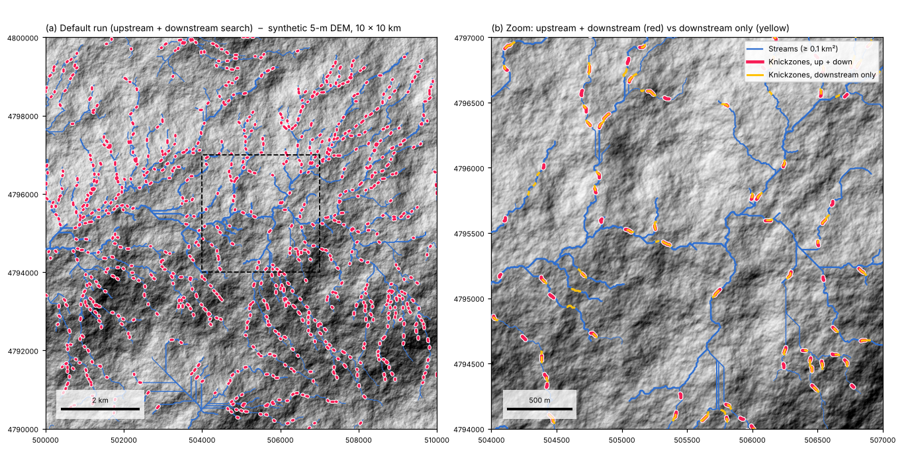
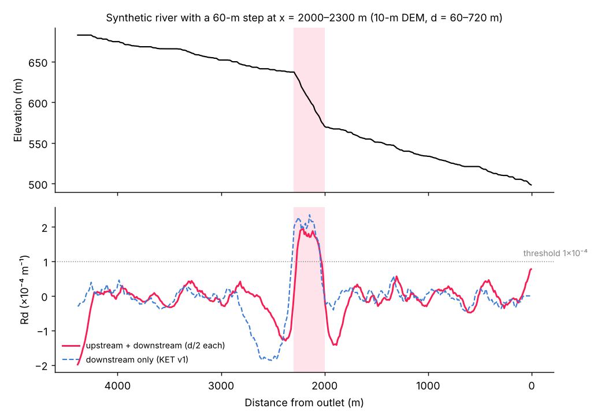

# KET-QGIS – Knickzone Extraction Tool v2

DEM を 1 枚入れるだけで、河川縦断形の遷急区間（knickzone）を抽出するツールです。
旧版 [KET (ArcGIS + TauDEM)](https://github.com/hdtopography/KET) を **numpy + GDAL だけ**で書き直しました。

- **QGIS** のプロセシングツールとして使えます（QGIS 以外のインストールは不要）。
- **QGIS なしでも**、numpy と GDAL が入った Python からコマンドラインで動きます。
- 勾配の計測を **上流・下流の両側（d/2 ずつ）** で行う方式（Hayakawa & Oguchi, 2006, 2009 の原法）と、
  旧 KET と同じ **下流側のみ** の方式を選べます。

A single-file tool that extracts fluvial knickzones from a DEM. It re-implements KET v1 (ArcGIS + TauDEM)
with numpy + GDAL only, runs inside QGIS or from the command line, and adds the original two-sided
(upstream + downstream) gradient measurement of Hayakawa & Oguchi (2006, 2009).



*合成 DEM（5 m、10 × 10 km）に既定設定で適用した結果。背景は地形陰影図、青線は河道（≥ 0.1 km²）、赤が遷急区間。右は両側探索（赤）と下流のみ（黄）の比較。 / Default-settings result on a synthetic 5-m DEM over hillshade; right: two-sided (red) vs downstream-only (yellow).*



*合成 DEM（x = 2000–2300 m に 60 m の段差）での Rd。両側探索（赤）は段差の位置にピークが来るのに対し、
下流のみ（青破線）はピークが上流側にずれ、段差の上流に負の谷ができる。*

---

## 使い方 / Quick start

**動作確認済み / Tested:** QGIS 3.4.8（GDAL 2.4.1, Python 3.6, macOS）、およびコマンドラインで Python 3.12 + GDAL 3.8。
それ以外のバージョンでも動くはずですが確認はしていません（不具合は Issue へ）。

### QGIS で（3.x）

1. プロセシングツールボックス上部の Python アイコン ▶ **「スクリプトをツールボックスに追加…」** で
   `ket_qgis.py` を選ぶ（初回のみ）。
2. **スクリプト ▶ KET ▶ Knickzone Extraction (KET)** を開き、**DEM を選んで「実行」**。

### QGIS なしで（コマンドライン）

```bash
# 例: conda の場合
conda install -c conda-forge gdal numpy

python ket_qgis.py dem.tif -o result
python ket_qgis.py dem.tif -o result --direction down --th 1.42e-5 --minheight 10
python ket_qgis.py -h        # オプション一覧
```

Windows で QGIS が入っていれば、付属の **OSGeo4W Shell** からも同じコマンドで動きます。
Python から `from ket_qgis import run_ket` として呼ぶこともできます。

### 出力

| 出力 | 内容 |
|---|---|
| **Knickzones**（線） | 遷急区間。属性: `length_m` 長さ, `height_m` 比高（区間内の標高レンジ）, `gradient` 平均勾配, `rd_mean` / `rd_max`, `z_top` / `z_bottom`, `area_km2` 下端の集水面積, `dist_head_m` 上端から本流をさかのぼった谷頭（尾根）までの距離, `dist_outlet_m` 下端から出口までの距離, 上端・下端の座標 |
| **Streams**（線） | 抽出に使った河道網 |
| **Rd raster** | 相対急峻度 Rd（1/m） |
| CSV | Knickzones の属性表 |

コマンドラインでは `knickzones.gpkg`, `streams.gpkg`, `rd.tif`, `knickzones.csv` が出力先フォルダに作られます。

---

## パラメータ

| パラメータ | CLI | 既定値 | 説明 |
|---|---|---|---|
| DEM | `dem` | – | GDAL で読めるラスタ。**緯度経度 DEM（基盤地図情報など）は自動で UTM に投影変換**。 |
| Stream threshold (km²) | `--area` | 0.1 | 河道とみなす集水面積の下限（Hayakawa & Oguchi, 2006 の谷頭の定義）。 |
| Search direction | `--direction` | both | `both`: 本流を d/2 さかのぼった点と d/2 下った点の間で勾配を計る。`down`: その点から d 下流まで（旧 KET）。 |
| Rd threshold (1/m) | `--th` | 0 = 自動 | Rd がこれより **大きい** 河道セルを遷急区間とする。自動 = 河道上の Rd の平均 + k×標準偏差。 |
| k（自動閾値） | `--k` | 1 | 自動閾値の標準偏差の倍数。 |
| Minimum length (m) | `--minlen` | 20 | これ以下の長さの区間を除去。 |
| Minimum height (m) | `--minheight` | 0 | これ未満の比高の区間を除去（2006 は 10 m、Zahra et al. 2017 は 15 m）。 |
| d from / to / by (m) | `--dfrom --dto --dby` | 0 = 自動 | 計測長 d の範囲。自動はセルサイズの **6, 36, 3 倍**。 |
| Compute Rd for every cell | `--all` | オフ | 全セルの Rd ラスタを作る（遅い）。通常は河道セルのみ。 |

### d の既定値について

Hayakawa & Oguchi (2006, 2009) は 50 m DEM 上で 80 m 間隔の計測点をとり、
**d = 320–1760 m を 160 m 刻み** で Gd を計算して Rd を求めました。
これをセルサイズ比に直すと 6.4–35.2 セル、3.2 セル刻みなので、既定値を **6–36 セル、3 セル刻み（11 段階）** としました。
10 m DEM なら 60–360 m、5 m DEM なら 30–180 m です。

この既定値は「DEM の解像度に応じて局所勾配から傾向勾配への移行帯を見る」という考え方に基づくもので、
地形的に意味のある長さは対象地域と DEM で変わります。高解像度 DEM（LiDAR 1 m など）では 6–36 m と短くなりすぎるので、
**m 単位で明示的に指定**することを勧めます（例: Zahra et al., 2017 は 10 m DEM で 30–1500 m、30 m 刻み）。

### 閾値の既定値について

自動閾値（平均 + 1 SD）は Zahra et al. (2017) の手順（対象地域の Rd の平均と標準偏差の和）に従っています。
論文で使われた値は次のとおりです。比較研究では値を明示して指定してください。

- 1.42×10⁻⁵ m⁻¹ — Hayakawa & Oguchi (2006, 2009)、50 m DEM、Rd の標準偏差の河川平均
- 1.92×10⁻⁴ m⁻¹ — Zahra et al. (2017)、10 m DEM、平均 + 標準偏差

---

## 方法 / Method

1. **窪地埋め** — priority-flood + ε（Barnes et al., 2014）
2. **D8 流向・集水面積**
3. **本流ポインタ（上流方向）** — 各セルに流れ込むセルのうち **集水面積が最大** のものを本流とする。
   面積が同じ場合は **標高が低い方**（＝勾配が緩い方）を選ぶ。流れ込むセルがなければ尾根（谷頭）。
4. **河道抽出** — 集水面積 ≥ 閾値
5. **多スケール勾配 Gd** — 各河道セルについて d ごとに
   - `both`: e₁ = 本流を d/2 さかのぼった点、e₂ = D8 で d/2 下った点、Gd = (e₁ − e₂) / (e₁〜e₂ の流路長)
   - `down`: e₃ = d 下った点、Gd = (e₀ − e₃) / 流路長（TauDEM SlopeAveDown と同じ）

   距離は D8 の各ステップの水平距離（直交 = セル幅、斜め = √2 倍）を積算し、累積が初めて d/2（d）に達した点を端点とする。
   上流側は **尾根に達したらそこまで**、下流側は出口や DEM 端に達したらそこまでの距離で計算する。
6. **相対急峻度 Rd** — Gd を d に対して最小二乗で直線回帰した傾き a を用いて **Rd = −a**（m⁻¹）。
   正の Rd は「d を伸ばすと勾配が下がる＝局所的に急」を意味する（Hayakawa & Oguchi, 2006; Zahra et al., 2017, Eq. 4）。
7. **遷急区間** — Rd > 閾値 の河道セルを D8 流路でつながる区間ごとにまとめ、長さ・比高などを計算し、最小長・最小比高で除去。

### 両側探索の性質

- 一様に急な区間が d の最大値の半分より長いと、区間の中央では Gd が d によらずほぼ一定になり、Rd が下がって区間が分割されることがある。
  これは原法（SAKE）と同じ性質で、d の上限は想定する遷急区間の長さより十分長くとる。
- 谷頭付近や出口付近では片側の距離が d/2 に届かないため、窓が非対称になる（取れた側の距離で計算）。
- 上流側は DEM の端で切れた流域を尾根と区別できない。**流域全体が DEM に含まれるように** 範囲をとること。

### 旧版 KET (v1, ArcGIS) との違い

| | v1 (ArcGIS) | v2 (this) |
|---|---|---|
| 必要なソフト | ArcGIS + Spatial Analyst + TauDEM + MPI | numpy + GDAL（QGIS 同梱）|
| 勾配の計測 | 下流のみ | 両側（既定）/ 下流のみ を選択 |
| **Rd の符号** | 回帰の傾き a をそのまま出力（`Finalraster`）、`Rd < 閾値` で抽出 | **論文の定義 Rd = −a**、`Rd > 閾値` で抽出（v1 の `Finalraster` = −Rd） |
| 遷急区間のまとめ方 | 8 近傍の RegionGroup | D8 流路上の連結 |
| 実行 | Part 1（Rd）と Part 2（抽出）の 2 段階 | 1 回で完了 |
| 追加属性 | – | 比高による除去、谷頭・出口からの距離、上下端座標 |

### 計算時間の目安

4,000,000 セル（2000×2000, 5 m）で約 14 秒（両側）、13 秒（下流のみ）。

### テスト

```bash
python tests/test_ket.py
```

合成 DEM を作り、ベクトル化した処理（本流の選択、端点探索、Gd、Rd）がセルごとの素朴な計算と一致すること、
既知の段差が遷急区間として抽出されることを確認します。

---

## References

- Hayakawa, Y.S., Oguchi, T. (2006) DEM-based identification of fluvial knickzones and its application to Japanese mountain rivers. *Geomorphology* 78, 90–106. https://doi.org/10.1016/j.geomorph.2006.01.018
- Hayakawa, Y.S., Oguchi, T. (2009) GIS analysis of fluvial knickzones distribution in Japanese mountain watersheds. *Geomorphology* 111, 27–37. https://doi.org/10.1016/j.geomorph.2007.11.016
- Zahra, T., Paudel, U., Hayakawa, Y.S., Oguchi, T. (2017) Knickzone Extraction Tool (KET) – A new ArcGIS toolset for automatic extraction of knickzones from a DEM based on multi-scale stream gradients. *Open Geosciences* 9, 73–88. https://doi.org/10.1515/geo-2017-0006
- Barnes, R., Lehman, C., Mulla, D. (2014) Priority-flood: An optimal depression-filling and watershed-labeling algorithm for digital elevation models. *Computers & Geosciences* 62, 117–127.

---

## ライセンス・引用 / License and citation

MIT License © 2026 Yuichi S. Hayakawa（[LICENSE](LICENSE)）。自由に使用・改変・再配布できます。論文等で使う場合は、上記 References の Hayakawa & Oguchi (2006)・Zahra et al. (2017) の引用をお願いします（[CITATION.cff](CITATION.cff)）。

Released under the MIT License. If you use this tool in a publication, please cite Hayakawa & Oguchi (2006) and Zahra et al. (2017).
